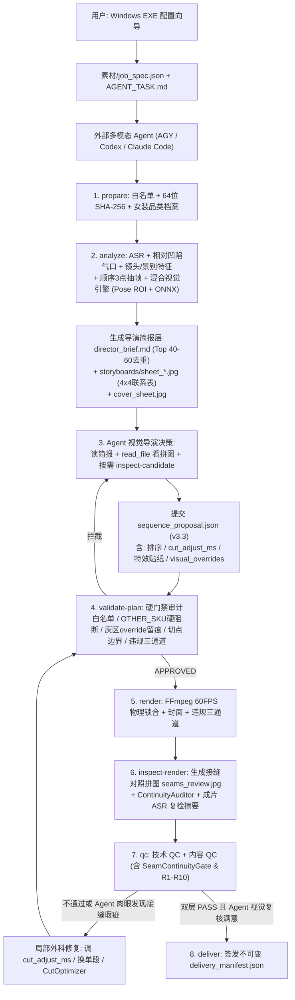

# dy-video V3.3 / V3.4 架构升级与演进总方案

> **版本**：V3.3 核心方案 + V3.4 演进预留（v1.0）  
> **决策依据**：[ADR-001](superpowers/plans/2026-11-21-adr-001-agent-first-architecture.md) · [ADR-002](superpowers/plans/2026-11-24-adr-002-visual-director-and-hybrid-perception.md)  
> **审查基线**：PR #16（分支 `feat/v3-agent-directed-ecommerce-editor`，HEAD `451eb80`）  
> **业务定位**：短期聚焦**女装直播切片带货**（45–65s 高转化成片，零串款、高质感、爆款节奏），架构预留多品类插件位。  
> **配套任务卡**：[`docs/dy-video-v3.3-v3.4-task-cards.md`](dy-video-v3.3-v3.4-task-cards.md)

---

## 1. 现状诊断与代码实查证据

PR #16 已经建成了非常扎实的 **Agent-First 控制权模型** 与 **工业级防篡改安全门禁**：
- `input_manifest (64位 SHA-256) -> candidate_pool_hash -> proposal_hash -> validated_plan_hash -> render_manifest -> dual_qc -> delivery_manifest` 全链闭环已跑通 `project-3` 本地验收；
- Windows EXE 与外部 Agent（AGY / Codex / Claude Code）实现彻底解耦；
- FFmpeg 子进程实时排空管道防死锁、进程树终止、历史成片隔离均已落地。

但对现行源码进行逐行核查后，系统在 **“导演视觉感知”、“剪辑细粒度可控性”、“V2/V3.2 模块闭环”** 和 **“代码健康度”** 四个层面存在明确瓶颈：

| 维度 | 代码证据（精确位置） | 实际影响 |
|---|---|---|
| **上下文爆炸** | `local_project3_v32_acceptance_summary.json`（`candidates_count: 797`）；`src/core/candidate_generator.py:71-157` 滑窗组合 | 外部 Agent 裸读 797 条候选 JSON 极易耗尽上下文并产生注意力稀释，难以通盘把握叙事节奏 |
| **盲人导片（缺拼图）** | `src/core/frame_provider.py:173-206` 仅存零散单中点帧，无 Contact Sheet 与封面对比板 | 外部多模态 Agent 只能看文字排片，无法用“眼睛”甄别模特神态、光线、构图与实穿同款 |
| **导演自由度受限** | `src/core/plan_compiler.py:119-168` 写死面料推镜、首个非 zoom 镜像与贴纸生成逻辑 | Agent 只能提交 `ordered_candidate_ids`，无法微调单段切点（±ms）、指定特效或优化贴纸文案 |
| **视觉感知退化** | `src/core/vision_backend.py:49-135` 使用**整帧 HSV 直方图**；未复用 `src/tools/detect_garment_match.py:47-120` 的 Pose 躯干 ROI + 白底剔除 + CLIP | 背景杂乱、灯光偏色、同色系不同款场景下极易误判；`vision_backend.py:136-145` 动作类型靠时长与文本硬猜，`motion_phase` 恒为 `"CORE"` |
| **抽帧性能瓶颈** | `src/core/frame_provider.py:193-198` 对每个候选单独 `VideoCapture` 打开→seek→释放 | 797 个候选反复打开高码率长视频 797 次，I/O 开销大且单中点帧漏检段尾换款 |
| **接缝审计与自修断链** | `src/runtime/stage_services.py:57` 导入 `ContinuityAuditor` 但全文件零调用；`stage_services.py:1518` 未传 `continuity_review` 给 `EditorialQcAuditor` | `SeamContinuityGate` 直接跳过，`CutOptimizer` 局部切点自修在 V3.2 主链完全未生效 |
| **V2 精品能力旁路** | `apply_violation_handling.py`、`detect_speech_pauses.py`、`extract_shot_features.py`、`slicing_rules.py`、`cut_style_rules.py` 未接入 `stage_services.py` | 偶含 1 个敏感词的黄金口播片段被一刀切拒选；参考片 R1–R10 切片/风格特征未喂给导演与 QC |
| **小 Bug 与三代债** | `src/runtime/stage_services.py:1739-1740` 重复 `rejections.append`；`desktop_spec_creator.py`（2530行）/`stage_services.py`（1810行）等 6 个超千行巨文件；`agy_headless.py` 与旧文档残留 | 维护成本高，外部 Agent 首次接入仓库易被 V2 / V3.1 / V3.2 三套并存口径误导 |

---

## 2. V3.3 目标架构：视觉导演全闭环（Visual Director Loop）

V3.3 不推翻 ADR-001，而是在既有 **7 阶段确定性 CLI** 上补齐 **“视觉摘要与联系表（看清）→ 导演级微调提案（可控）→ 成片接缝回看自修（会改）”** 闭环：



### 新增 / 增强后的 CLI 命令全景（`python -m src.cli`）

| 子命令 | 版本 | 核心职责 | 面向 Agent 的核心产出 |
|---|---|---|---|
| `prepare` | V3.2 增强 | 资产白名单、完整哈希、加载女装品类档案 | `run_context.json`、`input_manifest.json`、`product_profile.json` |
| `analyze` | V3.3 升级 | ASR/气口/景别、顺序 3 点抽帧、Pose ROI + ONNX 混合视觉打分、语义去重简报与 4×4 联系表 | `candidates.json`、`director_brief.md`、`storyboards/sheet_*.jpg`、`cover_sheet.jpg` |
| `inspect-candidate` | **V3.3 新增** | 按 ID 或筛选条件（`--role`/`--keyword`/`--gray-zone`）钻取单条或小批候选详情与 3 点原帧路径 | 结构化 JSON + 对应原帧路径（避免读全量 797 条） |
| `validate-plan` | V3.3 升级 | 审计 v3.2/v3.3 提案、`visual_overrides` 灰区放权校验、`cut_adjust_ms` 边界校验、违规词三通道计划生成、`ContinuityAuditor` 预审 | `validated_plan.json`、`plan_audit.json`、`violation_handling.json` |
| `render` | V3.2 增强 | 物理锁合渲染、应用单段微调与违规三通道、原子发布 | `output/<run_id>/final.mp4`、`cover.jpg`、`render_manifest.json` |
| `inspect-render` | **V3.3 新增** | 抽取成片全部 N-1 个接缝的前/中/后 3 帧拼成 `seams_review.jpg`，输出响度/语速/接缝诊断摘要 | `output/<run_id>/seams_review.jpg` + JSON 诊断摘要 |
| `qc` | V3.3 升级 | 技术 QC + 内容 QC（正式接入 `ContinuityAuditor`、`SeamContinuityGate` 与 R1–R10 风格断言） | `technical_qc.json`、`editorial_qc.json`、`continuity_review.json` |
| `deliver` | V3.2 增强 | 完整哈希链终审 + 记录 `visual_overrides` 审计溯源，签发不可变交付清单 | `delivery_manifest.json`、`output/latest.json` |
| `status` | V3.2 | 只读状态与进度查询（供 EXE 与 Agent 共用） | `run_state.json` 摘要 |

---

## 3. Phase 1：PR #16 合入前必改清债与断链修复

**目标**：在不引入 V3.3 大范围契约变动的前提下，清理 PR #16 实查出的缺陷与断链，确保 CI 全绿、文档唯一口径、安全合入 `master`。

1. **修复代码重复行与接缝门禁断链**
   - 删除 `src/runtime/stage_services.py:1740` 重复的 `rejections.append(...)`。
   - 在 `stage_qc()` 中调用 `ContinuityAuditor().audit_sequence_seams(plan["clips"], cand_map)`，落盘 `output/<run_id>/continuity_review.json`，并将结果传入 `EditorialQcAuditor.audit_editorial_quality(..., continuity_review=continuity_review)`，正式激活 `SeamContinuityGate`。
2. **修复 `vision_backend.py` 全图 HSV 退化（Phase 1 先接通躯干 ROI）**
   - 在 `LocalCVVisionBackend` 中优先调用 `detect_garment_match.py` 既有的 `torso_roi_from_pose`（若 MediaPipe Pose 可用）+ `_mask_white_background`（参考图去白底），无法检出人体时才安全降级为画面中心躯干启发框，并在返回中显式标注 `roi_mode: "pose_torso" | "center_crop" | "full_frame"` 与 `vision_engine`。
3. **收敛三代并存债与仓库卫生**
   - 从版本库移除或 `.gitignore` 根目录本地验收临时文件（`local_project3_*.json`、`agy_debug.log`、`tmp_out/`），保持 Git 工作树洁净。
   - 统一 `README.md` 为 V3.2 Agent-First 单一事实源（保留 V2 原子工具速查表作为“底层确定性原语附录”，消除两套并行流程说明的冲突）。
   - 清理无业务引用的 `src/runtime/adapters/agy_headless.py`（先确认对应测试迁移为 Agent-free 契约测试，不以删测试换绿）。
4. **回归验证门槛**
   - `python -u scripts/run_regression.py --quick` 100% 通过；
   - 新增单测覆盖：`ContinuityAuditor -> EditorialQcAuditor` 接缝 BLOCK 阻断用例、躯干 ROI 去白底比对用例。

---

## 4. Phase 2（V3.3 核心）：视觉导演套件与混合感知详细设计

### 4.1 顺序多点抽帧引擎（`src/core/frame_provider.py` 重构）
* **解决的问题**：消除 797 次重复打开/seek 视频的性能黑洞，同时补齐片段头尾换款/出画盲区。
* **设计方案**：
  - 新增批量接口 `extract_frames_batch(candidates, sample_ratios=(0.25, 0.50, 0.75))`：
    1. 按 `source_file` 分组，并将每组内所有待抽时间戳（ms）按**升序排序**；
    2. 对每个源视频**仅打开一次 `cv2.VideoCapture`**（若目标帧距当前帧很近则顺序 `grab()`，远距离才 `seek`），并采用 **时间量化桶去重**（如 500ms 桶内共享同一已抽帧文件，避免 797 个滑窗候选重复抽同一秒的画面）；
    3. 每个候选记录 `frame_refs: [p_25, p_50, p_75]`（均位于 `work/<run_id>/candidate_frames/`，文件名包含 `source_id` 哈希前缀，杜绝同 stem 不同扩展名冲突）。
  - 兼容保留原有 `get_frames_for_candidate(cand)` 单条调用接口。

### 4.2 混合本地视觉引擎（`src/core/vision_backend.py` v2）
遵循 **ADR-002 D2（本地零 API 费 + CPU/GPU 通用）**，构建分层可插拔视觉后端：

```text
候选 3 点帧 (25%/50%/75%)
   │
   ├─► [Stage 1: 前景聚焦] MediaPipe Pose 躯干 ROI 裁切（女装核心关注区：肩-髋/连衣裙延展至膝）
   │                      商品参考图自动剔除白底背景 (_mask_white_background)
   │
   ├─► [Stage 2: 向量编码] 优先: OnnxGarmentEncoder (MobileCLIP-S2 / SigLIP-base ONNX, ~300-600MB)
   │                      自动检测 CUDAExecutionProvider → 回退 CPUExecutionProvider
   │                      首次按需下载至用户缓存目录 (~/.cache/dy-video/models/)，校验 SHA-256
   │                      离线/缺权重降级: TorsoHSVBackend (显式标注 vision_tier="weak_fallback")
   │
   └─► [Stage 3: 3点聚合与动作/景别感知]
         • 分别计算 25%/50%/75% 与商品参考图集的最大/均值余弦相似度
         • 若 min_sim 与 max_sim 落差过大（如段尾换款离开），标记 risk: "MID_CLIP_SKU_DRIFT"
         • 复用 extract_shot_features.py 真实填充 shot_scale (FULL_BODY/HALF_BODY/CLOSEUP)、
           face_visible、motion_blur 与 action_type，替代原版靠时长硬猜的逻辑
```

**三区间判定逻辑（阈值统一收口于 `contracts/constraints.yaml` 的 `vision_v33` 段）**：
* **高置信同款区**：`score >= high_threshold`（ONNX 默认建议 `0.76`，经真实 5 款女装标定后微调）且三帧无剧烈漂移 → `SAME_SKU`；
* **灰区（待 Agent 终审）**：`low_threshold <= score < high_threshold`（如 `0.52 ~ 0.76`）或处于弱降级模式 → `UNCERTAIN` + `visual_gray_zone: true`；
* **明确异款区**：`score < low_threshold`（如 `< 0.40`）且与换款/品类负向词共振 → `OTHER_SKU`。

### 4.3 导演简报与视觉联系表（`Director Brief` + `Contact Sheets`）
新增模块 `src/core/director_digest.py`，在 `stage_analyze` 末尾自动生成：

1. **候选池分层压缩（解决 797 条上下文爆炸）**：
   - 保持 `analysis/candidates.json` 仍为全量冻结事实源（保障 `candidate_pool_hash` 完整可溯源）；
   - 按 `duplicate_cluster_id` 与时间重叠度做 **NMS 代表抽样**，每簇仅选 1 条综合分最高且句末闭合的代表，再按叙事角色配额（`HOOK` / `FABRIC` / `FIT` / `STYLING` / `COLOR` / `CLOSING`）选出 **Top 40–60 条精选候选**，额外附带最多 **12 条高口播分灰区候选（`gray_zone_candidates`）** 供 Agent 肉眼抢救。
   - 输出极易被 LLM 阅读的 `analysis/director_brief.md`（约 4–8 KB）和结构化 `analysis/director_brief.json`。每行包含：`candidate_id` | `源&时长` | `角色` | `SKU状态/分数` | `景别` | `命中卖点` | `风险` | `完整台词` | `所属拼图格号(S01-#04)`。

2. **分镜视觉联系表（`analysis/storyboards/`）**：
   - **分镜拼图 (`sheet_01.jpg` .. `sheet_N.jpg`)**：每张分辨率 `1920×1920`（4×4 = 16 格，单格 `480×480`），每格展示该候选核心帧（或 25%/50%/75% 三联横条），顶部半透明黑条印粗体 `ID + 格号 + 时长 + 角色`，底部印 `SKU状态(绿=SAME / 黄=GRAY / 红=OTHER) + 得分 + 12字口播摘要`。
   - **封面候选对比板 (`cover_sheet.jpg`)**：把全部 `cover_candidates`（通常 3–8 张）按 2×3 或 2×4 拼在同一张图上，标注 `cover_id`、清晰度、偏航角、衣着匹配分、OCR 纯净度，Agent 看 1 张图即可定封面。

3. **按需钻取 CLI（`inspect-candidate`）**：
   ```bash
   python -m src.cli inspect-candidate --run "<work_dir>" --ids "c_src1_012,c_src1_045"
   python -m src.cli inspect-candidate --run "<work_dir>" --role FABRIC --gray-zone --top 10
   ```
   仅返回目标候选的完整字级时间戳、相邻上下文台词（前一句/后一句，方便判断逻辑衔接）、3 点原帧路径与视觉特征明细。

### 4.4 `sequence_proposal.json` v3.3 导演微调契约与灰区放权门禁

升级 `contracts/schemas/sequence_proposals_v33.schema.json`（完全向下兼容 v3.2），赋予外部 Agent 精细导演权：

```json
{
  "schema_version": "3.3",
  "run_id": "run_20261124_01",
  "candidate_pool_hash": "<24位冻结候选池哈希>",
  "proposal_id": "director_cut_v1",
  "agent_name": "claude-code",
  "style": "balanced",
  "ordered_candidate_ids": ["c_s1_003", "c_s1_019", "c_s2_007"],
  "chosen_cover_id": "cand_01_live01",
  "hook_card_override": {
    "text": "秋冬显瘦神款 · 软糯亲肤不扎肉"
  },
  "cta_override": {
    "text": "戳左下角小黄车看上身尺码"
  },
  "clip_overrides": {
    "c_s1_019": {
      "cut_adjust_start_ms": 0,
      "cut_adjust_end_ms": 220,
      "zoom": 1.28,
      "effect": "none",
      "sticker_text": "细腻亲肤针织"
    },
    "c_s2_007": {
      "effect": "hflip",
      "sticker_text": "正肩显瘦版型"
    }
  },
  "visual_overrides": [
    {
      "candidate_id": "c_s2_007",
      "original_relation": "UNCERTAIN",
      "override_relation": "SAME_SKU",
      "inspected_frame_refs": [
        "analysis/storyboards/sheet_02.jpg#07",
        "candidate_frames/c_s2_007_p50.jpg"
      ],
      "visual_evidence_note": "主播身穿同款燕麦色V领绞花针织衫，袖口螺纹与平铺参考图一致，因侧身暖光导致本地相似度0.61落入灰区"
    }
  ],
  "violation_mitigation_mode": "auto_three_channel",
  "decision_reasons": [
    "开场痛点句完整且主播正脸有感染力",
    "中段 3 个镜头覆盖面料近景→正肩版型→全身穿搭，景别不重复"
  ]
}
```

**`validate-plan` 硬门禁新增 4 项审计规则**：
1. **`visual_overrides` 严格审计**：
   - 目标 `candidate_id` 原关系必须为 `UNCERTAIN`；若原关系为 `OTHER_SKU` 或存在换款词/负向品类冲突，**直接 REJECT**；
   - `inspected_frame_refs` 至少包含 1 个位于当前 `work_dir` 内真实存在的帧或拼图文件（通过 `realpath/commonpath` 防路径穿越）；
   - `visual_evidence_note` 长度需 ≥ 10 个有效字符，不可为空；
   - 审核通过后，写入 `plan_audit.json` 与 `validated_plan.json` 的 `agent_visual_overrides` 审计块，并透传至 `delivery_manifest.json`。
2. **`cut_adjust_start_ms / cut_adjust_end_ms` 安全边界校验**：
   - 绝对值上限默认 `±500ms`（可于 `constraints.yaml` 配置）；
   - 调整后严禁跨过源视频边界 `[0, source_duration_ms]`，严禁造成同源片段时间重叠，且需结合 ASR 词级时间戳校验不得向内倒切吞字（若检测到截断词尾，阻断或给出建议气口偏移量）。
3. **`sticker_text / hook_card_override` 防造假与合规校验**：
   - 同样过 `detect_price`（零价格）与 `detect_violation`（零极限词）；
   - 若包含具体材质/克重/成分词（如“100%羊绒”“90白鸭绒”），必须核验 `product_profile` 或对应候选台词中存在事实依据，杜绝 Agent 杜撰卖点。
4. **违规词三通道按需挽救（`violation_mitigation_mode`）**：
   - 默认仅对 `WARN` 级或可安全消音的单点敏感词启用 `apply_violation_handling.py`，自动生成 `work/<run_id>/violation_handling.json`（字幕 `***` + 音频精准消音 + OCR 像素化），使优质片段无需整段作废；高危红线词仍保持硬阻断。

### 4.5 成片接缝回看 Critic Loop（`inspect-render` + 局部自修）
补齐 V3.2 缺失的 **“剪辑师拉进度条复看成片”** 环节：
* **`python -m src.cli inspect-render --run <work_dir>`**：
  1. 读取 `validated_plan.json` 与 `output/<run_id>/final.mp4`，按累计时间轴定位全部 `N-1` 个真实物理接缝时间戳 `t_seam`；
  2. 为每个接缝抽取 `[t_seam - 0.25s, t_seam, t_seam + 0.25s]` 三帧横排对比条，标注左段 ID 尾句、右段 ID 首句、是否跨源、音量跳变 dB 值，拼成 1 张 `output/<run_id>/seams_review.jpg`；
  3. 同时输出成片综合视觉审阅包路径：`cover.jpg`、`seams_review.jpg`、与 `ContinuityAuditor` + `verify_final_video_asr` 的结构化摘要；
* **自修复闭环**：
  - 外部 Agent 用 `read_file` 快速扫一眼 `cover.jpg` 与 `seams_review.jpg`，如发现某接缝存在“嘴未闭完”、“手势被拦腰切”或“跨源亮度跳变过大”，仅需修改 `sequence_proposal.json` 中对应片段的 `cut_adjust_end_ms` 或替换 1 个候选，重跑 `validate-plan -> render -> qc`（后续可对未变更片段复用切片缓存提速），实现外科手术式局部修复。

### 4.6 女装品类模板化与多品类插件预留
将硬编码在各模块里的女装知识抽离为数据驱动配置：
* 目录：`contracts/profiles/womenswear.yaml`（默认激活，内置子品类覆写：`knitwear`、`outerwear`、`dress`、`pants`）。
* 统一定义：
  - `category_synonyms`（本品自然口播扩展词，如针织衫→大毛衫/线衫/纱线）；
  - `negative_category_terms`（同直播间常见干扰品类冲突词）；
  - `styling_context_patterns`（合规搭配语境正则）；
  - `torso_roi_strategy`（上衣取肩-髋、连衣裙取肩-膝、裤装取腰-踝）；
  - `funnel_roles` & `rhythm_curve`（女装黄金漏斗顺序与 R1–R10 节奏参数）；
  - `verified_fabric_lexicon`（允许自动生成贴纸的常见女装材质/版型词库）。
* 后续扩展美妆/食品/3C 时，仅需新增 `contracts/profiles/<domain>.yaml` 并在 `job_spec.json` 指定 `product.domain_profile`，核心管线零侵入。

---

## 5. Phase 3（V3.4 演进预留）：商业质感与矩阵扩展点

> 本阶段不阻塞 V3.3 交付，但在 V3.3 改造中提前保持接口整洁，便于后续平滑接入：

1. **薄层本地 MCP Server（`src/mcp_server.py`）**：直接包装 `src.runtime.stage_services` 与 `director_digest`，把 `prepare/analyze/inspect-candidate/validate-plan/render/inspect-render/qc/deliver` 暴露为原生 MCP Tool（图像结果可直接返回 ImageContent），供 AGY / Claude Code / Codex 零 Shell 拼接调用。
2. **混合高级动效透明叠加层（Hybrid Alpha Overlay）**：在 `video_assembler.py` 预留 `overlay_mov_path`（ProRes 4444 / WebM VP9 Alpha）输入槽位；未来可用 HTML/CSS（Playwright）或 Remotion 仅渲染前 2.5 秒高定动效 Hook 卡与丝滑卖点弹幕，再由 FFmpeg 极速叠合到 60FPS 实拍流。
3. **剪映草稿导出（`python -m src.cli export-jianying --run <work_dir>`）**：参考 `pyJianYingDraft` 协议，在 `validated_plan.json` 基础上增加独立导出桥接器（与现有 `chatcut_bridge.py` 同层并列），支持导出多轨剪映草稿供人工运营在 1 分钟内二次精修音乐或转场。
4. **投流 A/B Hook 矩阵渲染（`variants`）**：在 `sequence_proposal.json` 预留 `variants` 列表结构，支持共享中后段渲染好的物理片段，仅替换前 3 秒 Hook 片段与 Hook 卡文案，低耗时批量产出 3 条差异化测款视频。

---

## 6. 代码模块化瘦身规划

针对当前单文件过大的维护风险，在 Phase 1 & Phase 2 演进中逐步拆解，不搞“推倒重写”：

| 当前巨型文件 | 现状行数 | 渐进式拆分方向 |
|---|---|---|
| `src/runtime/stage_services.py` | 1,810 行 | 按阶段拆为 `src/runtime/stages/` 包：`prepare.py`、`analyze.py`、`validate_plan.py`、`render.py`、`inspect.py`、`qc_deliver.py`、`security.py`；原 `stage_services.py` 保留薄门面重导出（100% 兼容现有 import 与测试） |
| `src/core/vision_backend.py` | 156 行（待扩展） | 拆为 `src/core/vision/`：`base.py`、`roi.py`（复用 `detect_garment_match`）、`onnx_encoder.py`、`hsv_fallback.py` |
| `src/agent/agent_director.py` & `src/runtime/job_runner.py` | 1,462 + 486 行 | 明确标注为 legacy 兼容层，停止向其堆砌 V3.3 新逻辑；所有新能力统一落入 `src/runtime/stages/` 与 `src/core/` |
| `src/tools/desktop_spec_creator.py` | 2,530 行 | V3.3 仅在交接模板 `AGENT_TASK.md` 中补充“看拼图 + `inspect-render`”指引，不顺手大改 GUI 避免引入回归 |

---

## 7. 总体里程碑与验收标准（DoD）

### Phase 1 完成门槛（PR #16 准予合入）
- [ ] `stage_services.py` 重复行修复，`ContinuityAuditor -> EditorialQcAuditor` 全线接通并有单测验证；
- [ ] `vision_backend.py` 接入 Pose 躯干 ROI + 参考图去白底；
- [ ] 根目录临时调试/验收文件清理完毕，`README.md` 与 `.agents/skills/.../SKILL.md` 口径完全统一；
- [ ] `python -u scripts/run_regression.py --quick` 全绿通过。

### Phase 2（V3.3）完成门槛（视觉导演正式版）
- [ ] 真实 `project-3`（3 源视频）运行 `analyze`：顺序 3 点抽帧耗时较旧版显著下降，稳定产出 `director_brief.md`（Top 40–60 去重）、`storyboards/sheet_*.jpg` 与 `cover_sheet.jpg`；
- [ ] 混合视觉后端在有 ONNX 模型时正常走语义向量打分，在无模型/离线环境下自动降级为躯干 ROI HSV 并显式标注 `weak_fallback`；
- [ ] 外部 Agent 提交 v3.3 提案（含 `cut_adjust_ms`、`clip_overrides` 与 `visual_overrides`）：
  - 对 `UNCERTAIN` 灰区带真实帧证据的放权通过校验并完整写入 `delivery_manifest.json` 审计块；
  - 对 `OTHER_SKU` 的越权覆盖、虚假帧路径、超限切点微调或杜撰面料贴纸 100% 硬阻断；
- [ ] `inspect-render` 成功生成全部接缝对照拼图 `seams_review.jpg`，且串联 `ContinuityAuditor` + `CutOptimizer` + `verify_final_video_asr`；
- [ ] 女装品类词表与 ROI 策略抽离至 `contracts/profiles/womenswear.yaml`，核心代码无散落硬编码品类规则；
- [ ] 全量 CI 快速回归 + 本地 `project-3` 端到端闭环验收通过，原素材与历史成片 100% 只读无损。
