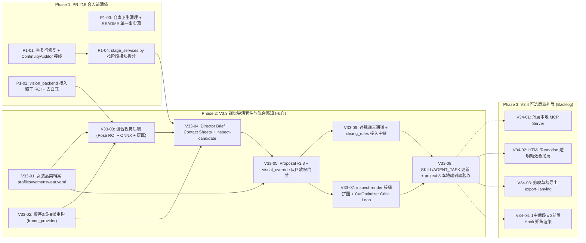

# dy-video V3.3 / V3.4 可执行工程任务卡（Agent-Ready Task Cards）

> **配套总方案**：[`docs/dy-video-v3.3-v3.4-architecture-upgrade-plan.md`](dy-video-v3.3-v3.4-architecture-upgrade-plan.md)  
> **决策依据**：[ADR-001](superpowers/plans/2026-11-21-adr-001-agent-first-architecture.md) · [ADR-002](superpowers/plans/2026-11-24-adr-002-visual-director-and-hybrid-perception.md)  
> **派发规范**：每张任务卡可独立派发给一名开发 Agent 执行；**避免并行修改同一核心文件**；每完成一张卡必须运行卡内验收命令并保留通过证据，禁止删测试换绿。

---

## 总览与依赖关系

---

## Phase 1：PR #16 合入前清债与断链修复（P0）

### P1-01：修复 `stage_services.py` 重复代码并接通 `ContinuityAuditor -> EditorialQcAuditor`
- **优先级**：P0 | **依赖**：无
- **涉及文件**：
  - `src/runtime/stage_services.py`
  - `tests/test_pr16_round8_p0_p1.py`（或新增 `tests/test_continuity_qc_wiring.py`）
- **具体改动**：
  1. 删除 `src/runtime/stage_services.py:1740` 重复的 `rejections.append(...)`。
  2. 在 `stage_qc()` 中加载 `analysis/candidates.json` 构建 `cand_map`，调用 `ContinuityAuditor().audit_sequence_seams(plan.get("clips", []), cand_map)`，落盘 `output/<run_id>/continuity_review.json`。
  3. 将 `continuity_review` 传入 `ed_auditor.audit_editorial_quality(final_plan=plan, product_profile=product_profile, continuity_review=continuity_review)`，确保 `SeamContinuityGate` 真实执行并在 `stage_qc` 返回 JSON 中附上 `continuity_review_path`。
- **禁止事项**：不得改动既有 `deliver` 哈希链校验语义；不得弱化 `EditorialQcAuditor` 的 BLOCK 判定。
- **验收标准**：
  - 构造包含 `SKU_SWITCH` 接缝的计划，`stage_qc()` 必须返回 `editorial_qc.passed == False` 且 `SeamContinuityGate` 为 `BLOCK`；
  - `python -u scripts/run_regression.py --quick` 全部通过。

### P1-02：`vision_backend.py` 接入 Pose 躯干 ROI 与商品图去白底
- **优先级**：P0 | **依赖**：无
- **涉及文件**：
  - `src/core/vision_backend.py`
  - `src/tools/detect_garment_match.py`（仅复用已有纯函数，不破坏其 CLI）
  - `tests/test_sku_tracker.py`
- **具体改动**：
  1. 在 `LocalCVVisionBackend` 中复用 `detect_garment_match._mask_white_background` 剔除商品参考图纯白/灰背景。
  2. 对候选视频帧优先使用 `torso_roi_from_pose`（若环境中 MediaPipe Pose 可用且成功检出躯干）；未检出时安全退回画面中心躯干区域裁切（排除上下边缘与背景货架），在返回字典新增 `roi_mode`（`pose_torso` / `center_crop` / `full_frame`）与 `vision_engine: "hsv_roi"`。
  3. 同步更新 `vision_backend.py` 的相似度阈值读取逻辑，与 `contracts/constraints.yaml` 保持一致，避免硬编码魔数。
- **禁止事项**：不得在缺参考图或坏图时伪造 `vision_available=True`；不得在 CI 无 GPU / 无网络环境下触发大模型下载。
- **验收标准**：
  - 合成测试图（相同衣服 + 截然不同背景色）比对分显著高于全图直方图，异色衣服仍准确判低分；
  - `pytest tests/test_sku_tracker.py` 与 `python -u scripts/run_regression.py --quick` 通过。

### P1-03：仓库卫生清理、遗留 Adapter 评估清理与 `README.md` 单一事实源统一
- **优先级**：P1 | **依赖**：P1-01
- **涉及文件**：
  - `.gitignore`
  - `README.md`
  - `src/runtime/adapters/agy_headless.py`（若仍有测试引用则先迁移测试或显式标记 deprecated）
- **具体改动**：
  1. 将 `agy_debug.log`、`local_project3_*.json`、`tmp_out/` 加入 `.gitignore` 并清理工作树未跟踪或误提交的本地验收日志。
  2. 重整 `README.md`：以 **V3.2 Agent-First 工作流** 作为唯一主线说明，将旧 V2 工具表格收敛为「附录：底层确定性原子工具清单」，消除“两套并行流程”的阅读冲突。
  3. 审计 `agy_headless.py` 全部测试引用，确认 `src/` 业务代码零引用后将其安全归档或退役，对应单测迁移为 Agent-free 提案契约测试。
- **禁止事项**：不得删除任何历史真实视频素材；不得通过删除回归测试换取 CI 绿灯。
- **验收标准**：
  - `git status` 干净，根目录无临时调试日志与本地验收垃圾文件；
  - `python -u scripts/run_regression.py --quick` 全部通过。

### P1-04：`stage_services.py` 按职责拆分为 `src/runtime/stages/` 包（兼容门面）
- **优先级**：P1 | **依赖**：P1-01
- **涉及文件**：
  - `src/runtime/stages/`（新增 `security.py`, `prepare.py`, `analyze.py`, `validate_plan.py`, `render.py`, `qc_deliver.py`, `status.py`, `__init__.py`）
  - `src/runtime/stage_services.py`（转为薄门面，重导出全部公开函数与符号）
- **具体改动**：
  1. 将 1,810 行的 `stage_services.py` 按阶段无行为变化拆分为独立模块，每个文件控制在 200–450 行。
  2. `src/runtime/stage_services.py` 保留 `stage_prepare`、`stage_analyze`、`stage_validate_plan`、`stage_render`、`stage_qc`、`stage_deliver`、`stage_status`、`resolve_run_dir`、`resolve_trusted_paths`、`compute_candidate_pool_hash` 全部导出，保证既有单测与调用方 100% 零破坏。
- **禁止事项**：纯结构重构卡，严禁夹带业务逻辑修改。
- **验收标准**：
  - `python -u scripts/run_regression.py --quick` 全部通过，零 import 错误。

---

## Phase 2（V3.3 核心）：视觉导演套件与混合视觉感知

### V33-01：女装品类档案配置化（`contracts/profiles/womenswear.yaml`）与插件加载器
- **优先级**：P0 | **依赖**：Phase 1 完成
- **涉及文件**：
  - `contracts/profiles/womenswear.yaml`（新增）
  - `src/core/category_profile.py`（新增）
  - `src/core/sku_tracker.py`、`src/core/candidate_ranker.py`、`src/core/plan_compiler.py`
- **具体改动**：
  1. 将散落在 `sku_tracker.py`（品类扩展词、搭配正则、换款词）、`candidate_ranker.py`（催单叫卖正则、叙事角色关键词）与 `plan_compiler.py`（可信面料/版型贴纸词库）中的女装规则统一抽离至 `contracts/profiles/womenswear.yaml`，并细分子品类覆写（`knitwear`, `outerwear`, `dress`, `pants`）及躯干 ROI 策略（上衣肩-髋 / 连衣裙肩-膝 / 裤装腰-踝）。
  2. 新增 `load_category_profile(spec_or_profile)`，默认加载 `womenswear`，并在 `job_spec.schema.json` 的 `product` 下预留可选字段 `domain_profile`。
- **禁止事项**：不得破坏未填写 `domain_profile` 的既有 `job_spec.json` 兼容性。
- **验收标准**：
  - 修改 YAML 词表即可改变分类/过滤行为而无需改 Python 代码；
  - 既有 `test_sku_tracker.py`、`test_utterance_candidates.py`、`test_slicing_rules.py` 全部通过。

### V33-02：顺序多点抽帧引擎重构（`src/core/frame_provider.py`）
- **优先级**：P0 | **依赖**：Phase 1 完成
- **涉及文件**：
  - `src/core/frame_provider.py`
  - `src/runtime/stages/analyze.py`
  - `tests/test_frame_provider_batch.py`（新增）
- **具体改动**：
  1. 实现 `extract_frames_batch(candidates, sample_ratios=(0.25, 0.50, 0.75), bucket_ms=500)`：按源视频分组、时间戳升序排序、单次打开 `cv2.VideoCapture` 顺序抽帧，并在 500ms 桶内复用帧文件，避免 797 个滑窗候选重复解码。
  2. 每个候选回填 `frame_refs: [p25, p50, p75]` 与唯一 `frame_ids`（包含 `source_id` 前缀，保障同 stem 不同扩展名隔离）。
  3. 保持旧方法 `get_frames_for_candidate()` 兼容可用。
- **禁止事项**：严禁在多源模式下静默回退到第一段视频。
- **验收标准**：
  - 合成多源视频 200 候选测试中，每个源视频 `VideoCapture` 仅打开 1 次；同 stem 不同扩展名（`live01.mp4` vs `live01.mov`）帧文件零碰撞。

### V33-03：混合本地视觉后端（Pose 躯干 ROI + 轻量 ONNX 编码器 + 灰区/动作特征）
- **优先级**：P0 | **依赖**：P1-02、V33-01、V33-02
- **涉及文件**：
  - `src/core/vision/`（新增 `base.py`, `roi.py`, `onnx_encoder.py`, `hsv_fallback.py`）
  - `src/core/vision_backend.py`（兼容门面）
  - `src/core/sku_tracker.py`
  - `contracts/constraints.yaml`（新增 `vision_v33` 阈值段）
- **具体改动**：
  1. 实现 `OnnxGarmentVisionBackend`：加载轻量本地 ONNX 视觉编码器（如 MobileCLIP / SigLIP-base ONNX，~300–600MB，自动选 `CUDAExecutionProvider` → 回退 `CPUExecutionProvider`），权重存放用户缓存目录 `~/.cache/dy-video/models/`，缺失或禁用网络时自动降级到 `TorsoHSVVisionBackend` 并显式返回 `vision_engine: "hsv_fallback"`、`vision_tier: "weak"`。
  2. 对候选 3 点帧（25%/50%/75%）分别提取躯干 ROI 与去白底商品参考图算相似度，输出 `sim_min / sim_mean / sim_max`；若段内落差超阈值标记 `risk: "MID_CLIP_SKU_DRIFT"`。
  3. 明确三区间划分（高置信 `SAME_SKU` / 灰区 `UNCERTAIN` + `visual_gray_zone=True` / 明确异款 `OTHER_SKU`），所有阈值收口到 `contracts/constraints.yaml`。
  4. 复用 `src/tools/extract_shot_features.py` 为候选填充真实 `shot_scale`（全身/半身/特写）、`face_visible` 与清晰度，取代 `vision_backend.py` 原先靠时长硬猜的 `action_type` / `motion_phase`。
- **禁止事项**：CI 单元测试严禁强制联网下载几百 MB 权重；弱降级模式下在 `strict` 策略中不得直接判定高置信 `SAME_SKU`。
- **验收标准**：
  - Mock ONNX encoder 测试覆盖高置信/灰区/异款/段内漂移/离线降级 5 条路径；
  - `python -u scripts/run_regression.py --quick` 零网络全绿。

### V33-04：视觉导演简报（`Director Brief`）、分镜/封面联系表（`Contact Sheets`）与 `inspect-candidate` CLI
- **优先级**：P0 | **依赖**：P1-04、V33-02、V33-03
- **涉及文件**：
  - `src/core/director_digest.py`（新增）
  - `src/runtime/stages/analyze.py`、`src/runtime/stages/inspect.py`（新增）
  - `src/cli.py`
  - `tests/test_director_digest.py`（新增）
- **具体改动**：
  1. 在 `analyze` 末尾自动生成：
     - `analysis/director_brief.md` 与 `analysis/director_brief.json`：按语义聚类去重 + 漏斗角色配额，压缩为 **Top 40–60 精选候选** + 最多 **12 条高口播分灰区候选**，每条带 `candidate_id`、时长、角色、SKU 状态/分、景别、命中卖点、风险、完整口播与拼图格号（如 `S01-#04`）。
     - `analysis/storyboards/sheet_01.jpg ... sheet_N.jpg`：4×4 高清网格联系表（`1920×1920`），角标清晰印制 ID、时长、角色、SKU 颜色条（绿/黄/红）与 12 字口播摘要。
     - `analysis/storyboards/cover_sheet.jpg`：全部封面候选同屏对比拼板（标注 `cover_id`、清晰度、偏航角、衣着匹配分、OCR 纯净度）。
  2. 新增 CLI 命令 `python -m src.cli inspect-candidate --run <work_dir> [--ids ...] [--role ...] [--gray-zone] [--top N]`，支持按需钻取单条详情、前后句上下文与 3 点原帧路径。
  3. `analyze` 返回的 JSON 顶层直接输出 `director_brief_path`、`storyboard_sheets`、`cover_sheet_path` 供外部 Agent 第一时间读取。
- **禁止事项**：不得篡改或删减全量 `analysis/candidates.json`（保留完整候选池与 `candidate_pool_hash`）；中文标注渲染需兼容 Windows（`msyhbd.ttc`）与 Linux CI（`fonts-wqy-zenhei`）。
- **验收标准**：
  - 模拟 300 条候选输入时，`director_brief` 精准收敛在 40–60 条，生成的拼图 PNG/JPG 可正常解码且网格数与格号索引完全一致；
  - `inspect-candidate` 按 `--ids` 与 `--gray-zone` 筛选返回合法纯 JSON。

### V33-05：`sequence_proposal.json` v3.3 导演微调契约与 `visual_overrides` 灰区放权硬门禁
- **优先级**：P0 | **依赖**：V33-01、V33-04
- **涉及文件**：
  - `contracts/schemas/sequence_proposals_v33.schema.json`（新增）
  - `src/runtime/stages/validate_plan.py`
  - `src/core/plan_compiler.py`
  - `src/runtime/stages/qc_deliver.py`
  - `tests/test_proposal_v33_and_overrides.py`（新增）
- **具体改动**：
  1. 支持 v3.3 提案新增字段（完全向下兼容 v3.2）：`clip_overrides`（`cut_adjust_start_ms`, `cut_adjust_end_ms`, `zoom`, `effect`, `sticker_text`）、`hook_card_override`、`cta_override`、`visual_overrides`。
  2. 实现 `visual_overrides` 严格审计：
     - **硬红线**：原关系为 `OTHER_SKU` 或存在换款/负向品类冲突时 100% REJECT；
     - **仅限灰区**：仅允许覆盖 `UNCERTAIN`；
     - **证据核验**：`inspected_frame_refs` 必须至少有 1 条指向当前 `work_dir` 内真实存在的帧/拼图文件（防路径穿越），`visual_evidence_note` 不得为空（≥10 有效字符）；
     - **全链留痕**：审核通过的覆盖清单完整写入 `plan_audit.json`、`validated_plan.json`、`editorial_qc.json` 与 `delivery_manifest.json`（含 `has_agent_visual_overrides: true`）。
  3. 实现 `cut_adjust_*_ms` 边界门禁（默认绝对值 ≤ 500ms、不越界源视频、不导致同源重叠、结合 ASR 词级时间戳禁止向内倒切吞字）。
  4. 实现 `sticker_text / hook_card_override / cta_override` 价格/违规词检查及材质成分防造假校验（成分词须在 `product_profile` 或对应台词中有证据）。
  5. 升级 `compile_v3_plan()` 尊重已通过审计的 `clip_overrides`、`hook_card_override` 与 `cta_override`，而非全部写死覆盖。
- **禁止事项**：不得允许 Agent 发明不存在于 `candidate_pool_hash` 的 `candidate_id` 或越过 `±500ms` 上限任意修改时间戳。
- **验收标准**：
  - 单元测试覆盖至少 8 个安全断言：`OTHER_SKU` 越权覆盖拦截、空理由拦截、越界路径伪造帧拦截、超限 `cut_adjust_ms` 拦截、倒切吞字拦截、杜撰面料贴纸拦截、合法灰区 `visual_override` 放行并进入 `delivery_manifest.json`、旧版 v3.2 提案无缝兼容。

### V33-06：违规词三通道处理与参考片规则（R1–R10）接入 V3.3 主链
- **优先级**：P1 | **依赖**：V33-05
- **涉及文件**：
  - `src/runtime/stages/analyze.py`
  - `src/runtime/stages/validate_plan.py`
  - `src/runtime/stages/qc_deliver.py`
  - `src/tools/apply_violation_handling.py`、`src/tools/detect_speech_pauses.py`、`src/tools/slicing_rules.py`
- **具体改动**：
  1. 在 `analyze` 中接入 `detect_speech_pauses.py`（相对凹陷气口）与 `slicing_rules.py` 景别/视角特征，标注每个候选的 `pause_margin_ms` 与视角标签，供 `cut_adjust` 和导演选片参考。
  2. 在 `validate-plan` 支持 `violation_mitigation_mode: "auto_three_channel"`：对 `WARN` 级或可安全消音的单个敏感词，自动调用 `apply_violation_handling.py` 生成 `work/<run_id>/violation_handling.json`（字幕屏蔽 + 精准消音 + OCR 打码）并记录到 `plan_audit.json`；高危绝对阻断词仍保持 REJECT。
  3. 在 `qc` 阶段调用 `cut_style_rules` 输出 R7–R10 风格参考指标（WARN/INFO 级，不无故阻断合理创意，但给出明确量化反馈）。
- **禁止事项**：不得把 `BLOCK` 级价格词或高危违法词静默放过；三通道消音后的成片必须经成片 ASR 复检核实零残留。
- **验收标准**：
  - 包含单个可消音敏感词的合成片段在 `auto_three_channel` 下成功生成 `violation_handling.json` 并被 `VideoAssembler` 消费，成片字幕零残留。

### V33-07：成片接缝回看（`inspect-render`）与 `CutOptimizer` Critic 自修复闭环
- **优先级**：P0 | **依赖**：V33-05
- **涉及文件**：
  - `src/runtime/stages/inspect.py`
  - `src/cli.py`
  - `src/core/cut_optimizer.py`
  - `tests/test_inspect_render.py`（新增）
- **具体改动**：
  1. 新增 CLI 子命令 `python -m src.cli inspect-render --run <work_dir>`：
     - 解析 `validated_plan.json` 与 `output/<run_id>/final.mp4`，按真实切片时长计算全部 `N-1` 个接缝时间点；
     - 对每个接缝抽取 `[t_seam - 0.25s, t_seam, t_seam + 0.25s]` 三帧横排条，标注接缝编号、左右片段 ID、尾字/首字、是否跨源及 `ContinuityAuditor` 诊断结果，拼装为 `output/<run_id>/seams_review.jpg`；
     - 返回包含 `seams_review_path`、`cover_path`、`continuity_summary` 与 `CutOptimizer` 建议的 `suggested_clip_overrides`（Agent 可直接采纳或自行调整后写回 `sequence_proposal.json`）。
  2. 支持 `render` 阶段可选复用未变更分镜的物理切片缓存（按 `clip_content_hash` 索引），让局部修 1 个切点的重渲染耗时压缩到数秒级。
- **禁止事项**：`inspect-render` 为只读审阅工具，严禁自动修改 `validated_plan.json` 或覆盖 `final.mp4`。
- **验收标准**：
  - 合成 3 段拼接视频跑通 `inspect-render`，正确产出含 2 排×3 帧的 `seams_review.jpg` 与结构化 JSON 建议；
  - 局部修改 1 个分镜 `cut_adjust_end_ms` 后重跑 `validate-plan -> render -> qc -> deliver` 全链闭环通过。

### V33-08：更新外部 Agent Skill / `AGENT_TASK.md` 模板与真实 `project-3` 本地端到端验收
- **优先级**：P0 | **依赖**：V33-01 ~ V33-07
- **涉及文件**：
  - `.agents/skills/live-ecommerce-video-editor/SKILL.md`
  - `src/tools/desktop_spec_creator.py`（仅更新生成的 `AGENT_TASK.md` 任务指令模板，不改 GUI 结构）
  - `README.md`
- **具体改动**：
  1. 更新 `SKILL.md` 与 EXE 生成的 `AGENT_TASK.md`：明确指导外部 Agent 执行 **V3.3 视觉导演标准作业程序**（`prepare -> analyze -> 读 director_brief.md + 看 storyboards/sheet_*.jpg 与 cover_sheet.jpg -> 提交 v3.3 proposal -> validate-plan -> render -> inspect-render 看 seams_review.jpg -> qc -> deliver`）。
  2. 在用户本地 Windows 环境对真实 `project-3` 执行一次完整 V3.3 端到端验收（记录原素材只读哈希清单、抽帧耗时对比、简报压缩比、拼图产物、双层 QC 结果与人工视觉抽检结论），**验收日志不提交至 Git 仓库**。
- **禁止事项**：严禁将私有 `project-3` 视频、成片或绝对路径日志提交到 GitHub。
- **验收标准**：
  - `python -u scripts/run_regression.py --quick` 100% 全绿；
  - 外部 Agent 仅凭 `AGENT_TASK.md` + `SKILL.md` 无人工干预跑通 `project-3` 并交付双 QC 全绿成片。

---

## Phase 3（V3.4 可选演进 Backlog，不阻塞 V3.3）

> 以下任务卡在 V3.3 真实女装素材稳定出片后，按实际业务收益排期启动：

| 卡号 | 名称 | 核心产出 | 触发时机 |
|---|---|---|---|
| **V34-01** | 薄层本地 MCP Server（`src/mcp_server.py`） | 将 `src.cli` 全套能力与拼图直出封装为标准 MCP Tools（支持 ImageContent 返回） | 当希望 AGY / Claude Code / Codex 零命令行拼接直接调用时 |
| **V34-02** | 混合高级动效透明层（Hybrid Alpha Overlay） | 用 HTML/Playwright 或 Remotion 渲染前 2.5s 动效 Hook 卡/动态卖点弹窗为透明视频层，FFmpeg 极速叠合 | 当 PIL 静态 Hook 卡与 ASS 字幕成为点击率/质感瓶颈时 |
| **V34-03** | 剪映草稿导出器（`export-jianying`） | 基于 `validated_plan.json` 导出剪映多轨草稿（参考 `pyJianYingDraft` 协议，独立于 `render`） | 当运营团队需要频繁对 AI 成片做 1 分钟人工音乐/转场微调时 |
| **V34-04** | A/B Hook 投流矩阵渲染（`variants`） | 共享已渲染中后段切片缓存，一次提交生成 3 条不同前 3 秒 Hook 的去重测试成片 | 当进入抖音千川批量测款与高频放量阶段时 |
