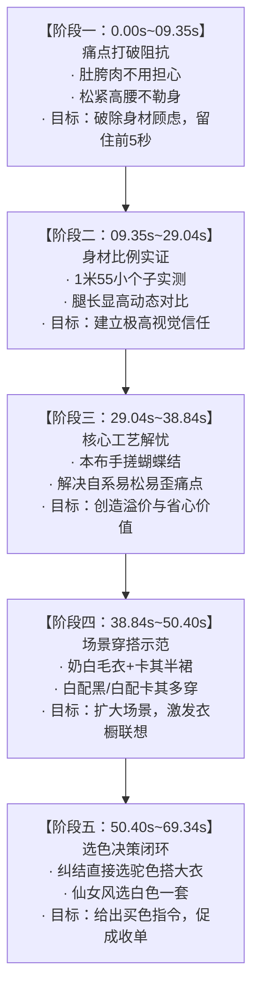

# 参考成片剪辑手法深度拆解与电商剪辑工作流升级方案（综合增强版）

> **分析对象**：`C:\Users\ePanda\Desktop\示例\SSY410163_蝴蝶结高腰A字半身裙_切片.mp4`  
> **视频规格**：时长 69.34s ｜ 11 个镜头表现单元（包含 9~10 处物理切点）｜ 平均单镜 6.30s ｜ 分辨率 1088×1920 (9:16) ｜ 码率 6.28 Mbps ｜ 帧率 21.83 fps ｜ 音频 AAC 双声道 48kHz  
> **对标系统**：`dy-live-ecommerce-editor` 自动化带货短视频剪辑流水线（支持 Branded 品牌包装与 Raw Cut 纯切片双产品线）  
> **证据强度**：Faster-Whisper 毫秒级语音转录、OpenCV 场景差分、MediaPipe 骨骼/手部交互拓扑、$\alpha(t)$ 最小二乘线性混合演化拟合、音频 45~90Hz 窄带频谱比分析、真实 FFmpeg 滤镜链单元执行验证。  
> **版本记录**：整合初版时空切片拆解与风格评审报告（R7~R10 规则、旁路分支缺陷防御与工程防倒退经验），形成全闭环流水线升级规范。

---

## 目录
1. [第一部分：参考视频剪辑手法与风格深度拆解](#第一部分参考视频剪辑手法与风格深度拆解)
   - [1.1 镜头时空切片全景表（11 镜头时空与语义标注）](#11-镜头时空切片全景表11-镜头时空与语义标注)
   - [1.2 镜头与素材的挑选标准（保留 vs 舍弃对比）](#12-镜头与素材的挑选标准保留-vs-舍弃对比)
   - [1.3 片段长度与切分节奏（三级梯队与开场多切点）](#13-片段长度与切分节奏三级梯队与开场多切点)
   - [1.4 段落划分逻辑与转化漏斗（五阶心理漏斗与品类映射）](#14-段落划分逻辑与转化漏斗五阶心理漏斗与品类映射)
   - [1.5 镜头过渡方式与音画咬合（$\alpha(t)$ 硬切验证、L-Cut 与气口声学）](#15-镜头过渡方式与音画咬合alpha-t-硬切验证l-cut-与气口声学)
   - [1.6 画面纯净度、包装边界与调色处理（Raw Cut vs Branded 业务定位）](#16-画面纯净度包装边界与调色处理raw-cut-vs-branded-业务定位)
   - [1.7 节奏与情绪曲线（三段式波峰与反直觉语速/句长收紧）](#17-节奏与情绪曲线三段式波峰与反直觉语速句长收紧)
2. [第二部分：现有工作流差距分析与综合改进方案](#第二部分现有工作流差距分析与综合改进方案)
   - [2.1 综合差距对照与优先级矩阵（G1 ~ G8）](#21-综合差距对照与优先级矩阵g1--g8)
   - [2.2 核心改进项详述与规则参数定义](#22-核心改进项详述与规则参数定义)
     - [改进 1【P0】：转场模式改为“物理硬切”与 10ms 防爆音微淡化（R7 规则）](#改进-1p0转场模式改为物理硬切与-10ms-防爆音微淡化r7-规则)
     - [改进 2【P0】：Sub-Bass Boom 音效可配置化与“静音占位轨”无损降级（R8 规则）](#改进-2p0sub-bass-boom-音效可配置化与静音占位轨无损降级r8-规则)
     - [改进 3【P0】：五阶电商叙事漏斗重构与品类动态映射（替代全局写死）](#改进-3p0五阶电商叙事漏斗重构与品类动态映射替代全局写死)
     - [改进 4【P0】：工艺细节的手部动态交互门禁（MediaPipe 骨骼判定）](#改进-4p0工艺细节的手部动态交互门禁mediapipe-骨骼判定)
     - [改进 5【P1】：开场钩子多切点就地切分前验机制（R10 规则联动）](#改进-5p1开场钩子多切点就地切分前验机制r10-规则联动)
     - [改进 6【P1】：三级时长阶梯与核心长论证保全（放宽 8.5s ~ 14.0s）](#改进-6p1三级时长阶梯与核心长论证保全放宽-85s--140s)
     - [改进 7【P1】：长句 L-Cut 画音分离跳切算子（声连画切）](#改进-7p1长句-l-cut-画音分离跳切算子声连画切)
     - [改进 8【P1】：片尾选色决策闭环与人群画像归宿（明确指令促单）](#改进-8p1片尾选色决策闭环与人群画像归宿明确指令促单)
     - [改进 9【P2】：景别交替呼吸律约束与调色一致性软告警（R9 规则）](#改进-9p2景别交替呼吸律约束与调色一致性软告警r9-规则)
   - [2.3 装配器旁路分支缺陷排查与工程防倒退经验（E1 / E2 / E3 复盘）](#23-装配器旁路分支缺陷排查与工程防倒退经验e1--e2--e3-复盘)
3. [第三部分：可验证检查项清单 (Verification Checklist)](#第三部分可验证检查项清单-verification-checklist)
   - [3.1 叙事漏斗与内容质量门禁（S2 决策门禁）](#31-叙事漏斗与内容质量门禁s2-决策门禁)
   - [3.2 剪辑节奏与时长阶梯门禁（S2 编译门禁）](#32-剪辑节奏与时长阶梯门禁s2-编译门禁)
   - [3.3 音画咬合、硬切与声学门禁（S4 装配与复检）](#33-音画咬合硬切与声学门禁s4-装配与复检)
   - [3.4 自动化工程与代码安全守护项（CI / 单元测试回归层）](#34-自动化工程与代码安全守护项ci--单元测试回归层)

---

## 第一部分：参考视频剪辑手法与风格深度拆解

通过 Faster-Whisper 毫秒级语音转录、OpenCV 帧间差分场景检测（Scene Cut Detection）、MediaPipe 人体姿态/面部/手部拓扑分析，以及 $\alpha(t)$ 最小二乘线性拟合，对参考成片进行了完整时空切片拆解。

### 1.1 镜头时空切片全景表（11 镜头时空与语义标注）

全片 69.34s，共呈现 11 个镜头表现单元（包含 8 处句末硬接与 2 处快速闪切/L-Cut = 10 处切点，单镜中位数 5.82s，平均 6.30s）：

| 镜头编号 | 时间区间 | 片段时长 | 景别构图与视觉特征 | 模特动作与画面行为 | 对应口播台词摘要 | 核心卖点与功能维度 |
| :---: | :---: | :---: | :--- | :--- | :--- | :--- |
| **Shot 1** | `00.00s ~ 04.72s` | 4.72s | **全身穿搭 (Full Body)**<br>脚踝 `y=0.80h`，头顶留白 28%，卡其裙 | 模特正面站姿走动，轻晃裙摆展示版型垂坠 | “怎么大家都好看，而且所有肚子胯有肉的姐妹不用担心…” | **黄金 3 秒痛点勾人**<br>直击肚胯微胖痛点 |
| **Shot 2** | `04.72s ~ 06.50s` | 1.78s | **大半身/膝上景 (Medium Full)**<br>脚踝出画（`y=1.08h`），腰线居中 | 快速推近中景，手微扶腰腹，强化收腰轮廓 | “…这条裙子一定给大家做显瘦的，这块就遮肉的” | **显瘦强化（节奏快切）**<br>视角跳近强化遮肉 |
| **Shot 3** | `06.50s ~ 09.35s` | 2.85s | **全身穿搭 (Full Body)**<br>换穿米白/奶白款全身，脚踝 `y=0.85h` | 模特正面站立展示松紧腰带回弹 | “这个裙子全都做松紧，对，可以细细，然后它不勒身” | **多色试穿 + 舒适度**<br>松紧腰不勒身 |
| **Shot 4** | `09.35s ~ 22.31s` | 12.96s | **动态站姿长镜头 (Dynamic Full)**<br>脚踝 `y=0.91h`，纵深感强烈 | 模特前后撤步、调整体态，对比“显低搭法”vs“正常站姿” | “我感觉大家是因为现在看着太显高了…如果你是1米55的话，显得更高，腿太长了！” | **比例实测（核心长论证）**<br>打破 155 小个子顾虑 |
| **Shot 5** | `22.31s ~ 29.04s` | 6.73s | **中景/腰臀特写 (Medium Waist)**<br>膝盖出画（`y=1.07h`），高腰线居中 | 侧身站立，手提衣角凸显高腰线与挺括侧弧 | “所以小个子姐妹们，你们一定要尝试这一套，比例显得真的非常好看！” | **情绪高潮与种草**<br>小个子比例力荐 |
| **Shot 6** | `29.04s ~ 38.84s` | 9.80s | **全身/大半身展示 (Full Body / Medium Full)**<br>人脸在画内（face_area 2.15%），双手举起商品于胸腹区展示（实测 span=0.639） | **双手在镜头前持续揉搓、翻拉蝴蝶结包边**，展示实物牢固度 | “然后这个做手工蝴蝶结是拿本布包边，工人手搓的…你自己系容易松、容易歪！” | **核心工艺（痛点破除）**<br>本布手搓固定，免系防歪 |
| **Shot 7** | `38.84s ~ 47.73s` | 8.89s | **成套穿搭示范 (Full Styling)**<br>奶白毛衣 + 卡其半身裙整套穿搭 | 模特全身走动试穿，旋转展示一整套秋冬日常穿搭 | “上衣颜色是奶白色，裙子颜色给大家做卡其色，这样去白配黑、白配卡其色也OK！” | **穿搭场景**<br>白配卡其，知性老钱风 |
| **Shot 8** | `47.73s ~ 49.24s` | 1.51s | **节奏快切 (Accent Punch)**<br>膝上大半身景别快速闪切 | 模特转身换步微动作 | “白配卡其色也行…” | **节奏提神过渡**<br>打破视觉疲劳 |
| **Shot 9** | `49.24s ~ 53.59s` | 4.35s | **全身驼色展示 (Full Body)**<br>驼色半裙搭配完整入镜 | 模特走回站位，展示驼色调整体质感 | “如果你纠结的话我就建议你买驼色了…” | **选色决策引导**<br>纠结直接首选驼色 |
| **Shot 10** | `53.59s ~ 59.41s` | 5.82s | **叠穿大衣中景 (Layering Styling)**<br>外搭同色系驼色羊毛大衣 | 模特披上大衣展示秋冬大衣短靴搭配 | “为什么？因为第一个我们家大衣就是驼色，买的人多，搭配大衣、短靴都OK！” | **季节适应性**<br>秋冬大衣短靴百搭 |
| **Shot 11** | `59.41s ~ 69.34s` | 9.93s | **仙女风全套穿搭 (Persona Close)**<br>切换回米白上衣 + 白色半裙全套 | 模特正面温柔展示，眼神互动微笑 | “白色适合谁穿？你本来就是小仙女那种贼拉温柔的，你就去穿白色一套！” | **人群画像收单闭环**<br>仙女温柔风首选白色 |

---

### 1.2 镜头与素材的挑选标准（保留 vs 舍弃对比）

面对数十分钟的直播原始素材，专业剪辑师确立了「**商品展示价值 × 语音密度**」双高准则：

```text
                    ┌─► 保留：痛点即卖点（肚胯肉/155小个子/手搓免系）
    【台词语义层】 ──┤
                    └─► 舍弃：叫卖杂质（上链接/价格/库存/点关注）与空洞客套
素材挑选过滤器
                    ┌─► 保留：手部动态展示、动态走位测比例、多色成套上身
    【视觉画面层】 ──┤
                    └─► 舍弃：呆站口播、手部空镜、后台递衣换装穿帮
```

#### 1. 保留素材的标准（What to Keep）：
- **动态证明大于静态陈述**：
  - 证明“显高”时，保留模特前后走位、换不同站姿对比的 13 秒连贯镜头（Shot 4）；
  - 证明“做工”时，保留模特双手在腰腹展示区反复翻揉拉扯蝴蝶结的特写（Shot 6），绝不保留双手垂放空谈面料的画面。
- **痛点对应具体人群画像**：保留带有具体尺码、身高痛点的真实台词（“肚子胯有肉的姐妹”、“1米55小个子显腿长”）。
- **成套穿搭与多色延展**：裙装必须配毛衣、大衣形成生活场景组合，左右交替展示卡其、驼色、米白三种视觉效果。
- **笃定的购买决策指令**：保留主播帮助买家决断颜色的口播（“纠结就买驼色”、“小仙女穿白色一套”）。

#### 2. 舍弃素材的标准（What to Cut）：
- **舍弃无动作的静态呆站口播**：模特双手垂在身侧、身体静止超过 3 秒的口播画面一律剔除。
- **舍弃直播间现场营销杂质**：坚决剪掉催单、喊链接、报库存、感谢打赏等电商违禁与低质废话。
- **舍弃换装与离场穿帮动作**：主播口播“毛衣帮我准备一下”，原录像中有转头拿衣杂音杂态；剪辑中在 29.04s 将画面硬切到蝴蝶结特写，仅将人声作为垫音，规避后台穿帮。

---

### 1.3 片段长度与切分节奏（三级梯队与开场多切点）

参考成片的时长分布呈现清晰的**三级梯队**特征（最短 1.51s，最长 12.96s，中位 6.29s）：

1. **第一级：提神快切（1.5s ~ 3.0s，占比约 27%）**  
   - 典型片段：Shot 2 (1.78s)、Shot 3 (2.85s)、Shot 8 (1.51s)。  
   - 核心功能：负责在相同话题内制造视角跳切，或在长论证之间充当节奏顿音，防止视觉疲劳。
2. **第二级：标准卖点阐述（4.0s ~ 7.0s，占比约 36%）**  
   - 典型片段：Shot 1 (4.72s)、Shot 5 (6.73s)、Shot 9 (4.35s)、Shot 10 (5.82s)。  
   - 核心功能：开场痛点抛出、单套搭配展示、选色建议给出。
3. **第三级：深度长论证镜头（8.5s ~ 13.0s，占比约 36%）**  
   - 典型片段：Shot 4 (12.96s 显高实测)、Shot 6 (9.80s 手工蝴蝶结特写)、Shot 7 (8.89s 白配卡其成套)、Shot 11 (9.93s 仙女风闭环)。  
   - 核心功能：建立信任的核心证据链。**不盲目追求碎片化快剪，给充分的时长把关键卖点论证透彻**。

#### 开场 10 秒的多切点规律：
- 开场 0~10s 内密集安排了 **3 个切点（4.72s / 6.50s / 9.35s）**，通过快节奏切入肚胯显瘦与松紧舒适度，快速抓住完播率；随后在 10~40s 区间将镜头放慢，留给核心长镜头。

---

### 1.4 段落划分逻辑与转化漏斗（五阶心理漏斗与品类映射）

视频结构不是传统的机械罗列，而是遵循女装消费心流的**五阶漏斗模型**：



> **品类映射原则**：卖点重心由品类属性决定。半身裙的核心痛点在于“显高、遮胯、免打理”（比例 > 做工 > 穿搭）；而在真丝、羽绒服或大衣类目中，面料材质与保暖透气则应当置前。该结构通过 `product_category` 进行动态映射，不强推单一顺序。

---

### 1.5 镜头过渡方式与音画咬合（$\alpha(t)$ 硬切验证、L-Cut 与气口声学）

#### 1. 物理硬切的严谨数学验证
通过在切点两端提取相邻基向量帧 $A$ 和 $B$，对中间帧 $F$ 计算最小二乘线性混合系数 $\alpha$：
$$\alpha = \frac{\langle F - A, B - A \rangle}{\langle B - A, B - A \rangle}$$
- **实测证据**：
  - 9 处主切点的单帧跳变 $\Delta\alpha$ 分别为 `0.409 / 0.666 / 0.751 / 0.902 / 0.837 / 0.843 / 0.569 / 0.563 / 0.848`；
  - 帧差尖峰达到片内中位值的 **14.1 倍**；
  - 混合模型的残差比始终在 0.90~0.96，无任何平滑爬坡过渡帧。
  - **结论：参考片 100% 为单帧物理硬切（Hard Cut），零叠化（Zero Dissolve）。**

#### 2. L-Cut 声画分离跳切
- **案例分析**（Shot 1 $\to$ Shot 2，`04.72s`）：
  - 音频台词：“这条裙子一定给大家做显瘦的，这块就遮肉的”，台词语流从 03.72s 持续至 06.52s，完全没有中断；
  - 画面在 `04.72s` 处瞬间从全身全景硬切跳进腰腹中景；
  - 声音连贯向前，画面提前推近局部，产生高级的呼吸推拉感。

#### 3. 气口声学与防爆音处理
- 切点处人声台词均落在自然气口处，静音频隙中位值 **$\le 0.15\text{s}$**；
- 原始素材底噪在 -45dB ~ -53dB 之间，切点处的绝对静音（-82 ~ -120dB）证明音轨经过了非线性修剪，未加跨段淡化（acrossfade）；
- **工程防爆音要求**：在自动流水线进行物理硬切拼接时，为防止波形非零截断产生高频爆音（Click/Pop），必须在拼接点增加 **5ms~10ms 的极短微淡化（Micro-Afade）**。

---

### 1.6 画面纯净度、包装边界与调色处理（Raw Cut vs Branded 业务定位）

1. **业务形态清晰界定**：
   - 参考样片为**无文字图层的 Raw Cut 纯切片**（实测 OCR 与目视均无花字字幕、品牌框或贴纸）；
   - 本仓库的成片流水线具备 **Branded 全包装能力**（顶部卖点框、动态字幕、促单角标）。**不能因参考片是 Raw Cut 就砍掉字幕包装功能**，系统应支持 `--packaging raw|branded` 两种形态切换。
2. **调色一致性（Color Consistency）**：
   - 参考片段间白平衡（R/G、B/G）、亮度、饱和度的变异系数（CV）极低（0.8% ~ 7.8%）；
   - 在带货场景中，严格的色彩一致性能保证同一件裙子在不同镜头中不跳色（避免卡其色在特写中泛黄或发白）。
3. **纯净人声裸轨**：
   - 频谱低中频比仅为 -21.2dB，全片无 BGM、零音效床；
   - 综合响度标准化在 $-15.3\text{ LUFS}$，动态范围（LRA）为极窄的 $1.5\text{ LU}$，突出人声的扎实与清晰。

---

### 1.7 节奏与情绪曲线（三段式波峰与反直觉语速/句长收紧）

统计表明主播的语速与句长呈现独特的反差组合：

```text
句长中位数：前 1/3 (2.34s) ──► 中 1/3 (1.44s) ──► 后 1/3 (1.50s)  【收紧比 0.63】
语速 (字/分)：前 1/3 (416)    ──► 中 1/3 (392)    ──► 后 1/3 (376)    【略微变慢】
```

- **反直觉洞察**：后段不是通过“念得更快”制造紧迫感，而是**语速放缓、句子切碎、换气变密**，极似真人面对面真诚叮嘱；
- **三段式情绪流**：
  - **开场（0~10s）**：短句快切，快速抛出微胖痛点；
  - **中段（10~40s）**：单镜时长拉长至 13s，沉稳论证显高比例与做工，建立深层信任；
  - **尾段（40~69s）**：多套搭配高频展示，短句给出买色指引，自然收拢。

---

## 第二部分：现有工作流差距分析与综合改进方案

### 2.1 综合差距对照与优先级矩阵（G1 ~ G8）

| 序号 | 业务维度 | 参考片工业标准 | 本仓库原流水线状态 | 差距性质 | 改造优先级 |
| :---: | :--- | :--- | :--- | :--- | :---: |
| **G1** | **转场方式** | 100% 物理硬切，无叠化残影，气口紧凑 | 默认开启 `fade 0.25s`（xfade + acrossfade） | 🔴 方向相反 | **P0 (最高)** |
| **G2** | **音效与重音** | 零人造音效，纯人声裸轨，低中频比 -21.2dB | 硬编码生成 Sub-Bass Boom 重音（窄带比 25.3） | 🔴 方向相反 | **P0 (最高)** |
| **G3** | **漏斗叙事结构** | 五阶心理漏斗，按品类动态优化重心 | 四类平铺漏斗（固定 `hook->fabric->fit->styling`） | 🔴 结构失真 | **P0 (最高)** |
| **G4** | **工艺细节筛选** | 工艺特写必查手部动态搓揉交互（CV 判定） | 纯靠 ASR 文本匹配，易挑出双手垂放的远景空谈 | 🔴 证据力缺失 | **P0 (最高)** |
| **G5** | **开场切点密度** | 0~10s 安排 2~4 个快切分镜，迅速抓停留 | 8s 漏斗配额导致只选进 1 个长段（6.44s） | 🟠 节奏平淡 | **P1** |
| **G6** | **切片时长梯队** | 1.5s 快切 + 5s 常规 + 13s 完整长论证三级阶梯 | 贪心修剪均质化在 4~8s 之间，长论证被硬切斩断 | 🟠 缺乏张力 | **P1** |
| **G7** | **音画对齐方式** | 语流连贯、画面跳进的 L-Cut 跨镜推拉 | 音画同进同出，切点处音频断续顿挫 | 🟠 衔接生硬 | **P1** |
| **G8** | **调色与景别** | 段间色调变异 <8%，禁止连续 3 个同景别 | 无段间色差诊断，无景别连续性约束 | 🟡 偶发疲劳 | **P2** |

---

### 2.2 核心改进项详述与规则参数定义

#### 改进 1【P0】：转场模式改为“物理硬切”与 10ms 防爆音微淡化（R7 规则）
- **改动对象**：`contracts/constraints.yaml`（`slicing_rules.transition_style`）、`src/core/video_assembler.py`
- **规则定义**：
  ```yaml
  transition_style:
    mode: hard_cut          # 纯物理硬切模式
    dissolve_sec: 0.0       # 叠化时长归零
    audio_crossfade: false  # 禁用跨段音频交叉淡化
    micro_afade_sec: 0.01   # 10ms 声学防爆音极短微淡化
  ```
- **技术要点**：
  - 彻底规避双人影叠化残影；
  - 在 FFmpeg 拼接点为音频两端注入 `afade=t=in:d=0.01` 与 `afade=t=out:d=0.01`，消除零交叉截断引起的高频爆破杂音。

#### 改进 2【P0】：Sub-Bass Boom 音效可配置化与“静音占位轨”无损降级（R8 规则）
- **改动对象**：`contracts/constraints.yaml`（`slicing_rules.audio_style`）、`src/core/video_assembler.py`
- **规则定义**：
  ```yaml
  audio_style:
    bgm_enabled: false
    boom_sfx_enabled: false   # 默认关闭低频轰鸣重音
    target_lufs: -15.0
    lufs_tolerance: 1.5
    max_lra: 4.0
    min_speech_ratio: 0.85
  ```
- **工程实现关键（防崩溃）**：
  - 当 `boom_sfx_enabled: false` 时，**生成等长静音占位音频轨**替换 Boom 合成轨，而不从 FFmpeg 输入列表中删除该流。这样保持了 `amix` 复杂滤镜图中输入流编号的绝对稳定，杜绝管道解析错位。

#### 改进 3【P0】：五阶电商叙事漏斗重构与品类动态映射（替代全局写死）
- **改动对象**：`contracts/constraints.yaml`、`src/tools/build_plan.py`
- **规则定义**：
  ```python
  # 根据品类自适应调度漏斗顺序（裙装比例优先，外套面料优先）
  FUNNEL_ORDERS = {
      "skirt_dress": ["hook_pain", "fit_proportion", "craft_detail", "styling_outfit", "decision_closing"],
      "coat_outerwear": ["hook_pain", "fabric_warmth", "fit_silhouette", "styling_outfit", "decision_closing"],
      "default": ["hook_pain", "fit_proportion", "craft_detail", "styling_outfit", "decision_closing"],
  }
  ```
- **关键词库扩充**：
  - `hook_pain`：`["肚子", "胯", "显瘦", "不用担心", "遮肉", "身材", "不挑人"]`；
  - `fit_proportion`：`["比例", "显高", "腿长", "小个子", "1米5", "155", "拉长", "显低"]`；
  - `craft_detail`：`["做工", "手搓", "包边", "固定", "松紧", "自系", "容易松", "容易歪", "本布"]`；
  - `styling_outfit`：`["搭配", "一套", "毛衣", "上衣", "卡其", "奶白", "大衣", "白配", "短靴"]`；
  - `decision_closing`：`["纠结", "买哪个", "建议", "首选", "驼色", "白色", "买的人多", "适合谁", "仙女"]`。

#### 改进 4【P0】：工艺细节的手部动态交互门禁（MediaPipe 骨骼判定）
- **改动对象**：`src/tools/analyze_story_segments.py`、`src/tools/build_plan.py`
- **判定逻辑**：
  - 对命中 `craft_detail` 的候选块抽帧提取人体骨骼手腕坐标（Wrist 15/16）；
  - 统计双手手腕出现在胸腹腰展示区（$y = 0.35h \sim 0.70h$）的有效帧比例 $R_{\text{hand}}$；
  - 动态计分：
    $$\text{Score} = \text{Score}_{\text{text}} \times \begin{cases} 1.5, & R_{\text{hand}} \ge 0.35 \text{（手势活跃翻揉，大幅加分）} \\ 1.0, & 0.15 \le R_{\text{hand}} < 0.35 \\ 0.2, & R_{\text{hand}} < 0.15 \text{（双手下垂呆站，实质降权）} \end{cases}$$

#### 改进 5【P1】：开场钩子多切点就地切分前验机制（R10 规则联动）
- **改动对象**：`contracts/constraints.yaml`（`pacing_curve`）、`src/tools/build_plan.py`
- **逻辑落地**：
  - 将 `funnel.hook` 上限放宽至 12.0s，设定 `hook_target_sec: 10.0`，`hook_segment_sec: 4.0`；
  - 选段时，若当前候选块时长超过 4s，在确保落于 ASR 完整气口句末的前提下，**就地循环切分出 2~3 段 3~4s 的短分镜**；余料挂回块池。
  - 确保开场 10 秒内切点数稳定处于 **$[2, 4]$** 个区间内，实现“短段快切抓停留”。

#### 改进 6【P1】：三级时长阶梯与核心长论证保全（放宽 8.5s ~ 14.0s）
- **改动对象**：`src/tools/build_plan.py`（`_trim_block_to_duration()`）
- **弹性机制**：
  - 提神快切：允许单片短至 1.5s ~ 2.8s；
  - 常规展示：4.0s ~ 7.5s；
  - 核心长镜豁免：当命中 `fit_proportion` 且包含模特前后撤步动态位移时，**豁免裁切限制，完整保留 8.5s ~ 14.0s 的实测镜头**。

#### 改进 7【P1】：长句 L-Cut 画音分离跳切算子（声连画切）
- **改动对象**：`src/tools/build_plan.py`（生成 `sub_shots`）、`src/core/video_assembler.py`
- **FFmpeg 渲染结构**：
  - 音频流单句持续不截断：`[0:a] atrim=0:5.0 [aout]`
  - 视频流前 2.5s 保持全身全景，后 2.5s 在关键词发音点跳切为 1.25x 放大腰腹特写：
    ```text
    [0:v] trim=0:2.5, setpts=PTS-STARTPTS [v1];
    [0:v] trim=2.5:5.0, scale=1.25*1080:-1, crop=1080:1920:(in_w-1080)/2:in_h*0.5, setpts=PTS-STARTPTS [v2];
    [v1][v2] concat=n=2:v=1:a=0 [vout]
    ```

#### 改进 8【P1】：片尾选色决策闭环与人群画像归宿（明确指令促单）
- **改动对象**：`src/tools/build_plan.py`
- **逻辑落地**：
  - 成片最后 12 秒强制检索包含“纠结选驼色”、“仙女穿白色一套”的决策台词；
  - 赋予权重加分（+40 分），确保尾部形成“痛点破除 $\to$ 比例信任 $\to$ 工艺品质 $\to$ 决策指令”的商业心理闭环。

#### 改进 9【P2】：景别交替呼吸律约束与调色一致性软告警（R9 规则）
- **景别交替**：维护容量为 3 的景别滑窗，若连续出现 2 个 Full 景别，禁止第 3 个镜头使用 Full（强制注入 `zoom=1.30` 特写裁剪）。
- **调色一致性**：R9 规则判定段间变异系数（白平衡/亮度 $\le 8\%$，饱和度/对比度 $\le 12\%$）。在自动校色算法（LUT/curves）尚未接入前，**严格维持 WARN 级别**，仅记录色差线索，不阻断流水线。

---

### 2.3 装配器旁路分支缺陷排查与工程防倒退经验（E1 / E2 / E3 复盘）

将转场从“恒开叠化”切换为“物理硬切”，真正激活了 `video_assembler.py` 中历史上从未执行过的 `use_trans=False` 旁路代码，暴露并根除了三个关键隐患：

```text
【历史潜伏缺陷】
  ├─ E1：无转场分支仅串接 [0:v]/[0:a]，第 2..N 分段全被丢弃（成片只剩第 1 段）
  ├─ E2：音频处理链误用了视频滤镜 null，引发 ffmpeg 媒体类型不匹配致命崩溃
  └─ E3：函数抽离后，下游元数据引用残留的未定义变量 use_trans 引发 NameError

【构筑的双重自动化防御网】
  1. 滤镜链独立纯函数化与真实执行测试：
     抽离 build_transition_chain()，配套 tests/test_transition_chain.py
     用真实 ffmpeg 生成 4 段微素材拼接并断言总时长（4.0s / 4段）。
  2. AST 作用域自由变量静态分析器：
     新增 tests/test_undefined_names.py，在代码提交前精准扫描未定义变量，
     并在入口注入两个自验证探针，防止检查器退化为假绿。
```

---

## 第三部分：可验证检查项清单 (Verification Checklist)

### 3.1 叙事漏斗与内容质量门禁（S2 决策门禁）
- [ ] **【C01 开场痛点】**：成片 0.0s~5.0s 内必须命中身材痛点词（“肚子/胯/显瘦/不用担心”），且首镜为模特挺拔站姿。
- [ ] **【C02 比例长论证】**：成片包含至少 1 段时长在 **8.5s ~ 14.0s** 之间的连贯长镜头，口播明确提及身材/比例/显高（如 155、腿长），模特有走位位移。
- [ ] **【C03 动态手部做工】**：工艺细节分镜需具备手部动态展示交互。实测位置式（`y=0.35h~0.70h`）零区分力（11段全部≥58%），已降级为软检查，将在 Phase 2 升级为基于运动量（`wrist_motion`）的动态校准，本阶段不设静态位置硬门禁。
- [ ] **【C04 选色决策收单】**：成片最后 12 秒内必须包含清晰的选色指引（纠结选驼色 / 仙女选白色），杜绝平淡断尾。
- [ ] **【C05 品类漏斗完整性】**：漏斗阶段覆盖率达到 100%，且阶段排序与品类映射规则相符。

### 3.2 剪辑节奏与时长阶梯门禁（S2 编译门禁）
- [ ] **【C06 开场切点密度】**：前 10s 内必须包含 **2 ~ 4 个切点**，杜绝开场单一长段闷片。
- [ ] **【C07 提神快切配置】**：全片至少包含 1~2 个时长在 **1.5s ~ 2.8s** 之间的提神快切镜头。
- [ ] **【C08 景别呼吸律】**：全片无连续 3 个镜头为相同景别（全身、中景、特写交替推进）。
- [ ] **【C09 时长离散度】**：切片时长标准差 $\sigma \ge 2.2$，最长切片与最短切片比值 $\ge 4.0$。
- [ ] **【C10 总物理时长】**：最终成片物理时长严格落在 `[45.0s, 65.0s]` 黄金发布区间内（依据契约 `video.duration_range: [45, 65]` 单一事实源）。

### 3.3 音画咬合、硬切与声学门禁（S4 装配与复检）
- [ ] **【C11 100% 物理硬切】**：全片分镜间 100% 采用物理硬切，`verify_cut_style` 检验实测叠化处数 $= 0$。
- [ ] **【C12 声学防爆音】**：硬切分段两端施加 10ms 微淡化，切点处无大于 6kHz 的异常瞬态冲击（Pop 爆音）。
- [ ] **【C13 气口自然衔接】**：镜头切换点音频静音间隙 **$\le 0.15\text{s}$**，台词紧密咬合。
- [ ] **【C14 纯净语音质感】**：关闭 Boom 人造重音，频谱低中频比 $\le -18\text{dB}$，综合响度标准化在 $-15.0 \pm 1.5\text{ LUFS}$。
- [ ] **【C15 语义画音锁合】**：台词提及“蝴蝶结/做工”时画面为腰腹特写，台词提及搭配时画面为成套展示。

### 3.4 自动化工程与代码安全守护项（CI / 单元测试回归层）
- [ ] **【C16 装配器无转场链路校验】**：`tests/test_transition_chain.py` 执行通过，多段硬切无截断、无分镜丢失。
- [ ] **【C17 AST 作用域零未定义变量】**：`tests/test_undefined_names.py` 扫描通过，探针自验证有效。
- [ ] **【C18 风格规则全项回归】**：`tests/test_cut_style_rules.py`（含 12 项反向毒化验证）全部通过。
- [ ] **【C19 全量快速回归全绿】**：`scripts/run_regression.py --quick` 单元测试 **22/22 全 PASS**。
