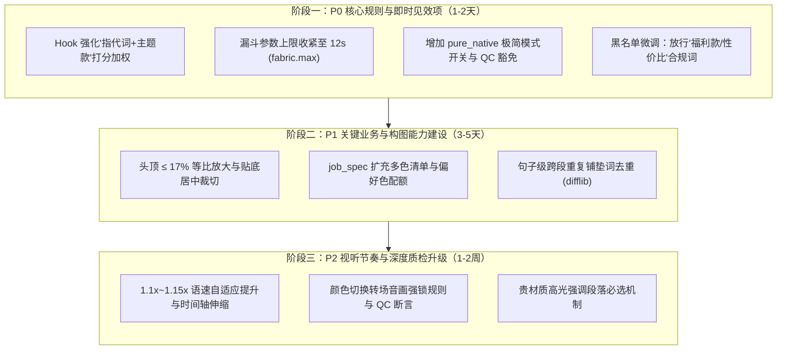

# 直播带货短视频工作流增强实践指南与实施建议
> 编制日期：2026-10-30  
> 适用工程：dy-live-ecommerce-editor (抖音带货直播切片自动化剪辑系统)  
> 目标定位：融合《女装达人直播切片提示词·最终整合版》的实战业务智慧，完善本仓库 Agent-in-the-Loop 自动化剪辑与质检体系。

---

## 一、 整体定位与架构适配原则

本仓库的核心优势在于**高确定性、零口型漂移、自动化量化质检与 Agent 智能体协同**。在吸纳业务导向的提示词（Prompt）经验时，应坚守以下三大适配原则：

1. **业务经验代码化与参数化**：将提示词中的“经验心法”（如“头顶留白不超过 17%”、“多讲场景少讲参数”、“偏好色占 60%”）转化为精确的数学公式、配置阈值与自动质检断言，而不是仅停留在 LLM 的模糊理解上；
2. **多模态与双流派解耦**：兼顾“**MIXCITY 高定包装流**”（带精修发光字幕、品牌条、高定封面）与“**纯原生生肉流**”（全片零字幕、零贴纸、纯真机实拍感），通过配置文件自由切换，不搞一刀切；
3. **真实素材守恒**：全链路坚持“仅从素材原声原画中提纯”，绝对不硬编台词、不引入 AI 生成语音（TTS），守住口型绝对物理咬合的工程底线。

---

## 二、 适合纳入工作流的具体实践与能力增强

---

### 实践 1：前 0—5 秒“强钩子 + 主题款明确”双任务决策机制

* **技术实践**：
  * 在分镜编译器中增加对 Hook 候选段的“主题款语义绑定”加权。
  * 优先选取达人真实口播中最早、最短、包含“**这件/这条/这双/这个 + 核心品类词（裙子/毛衣/大衣）**”且带有强吸引力（显白/显瘦/小个子适配/反差对比）的句子作为开场。
* **用途与收益**：
  * **解决品类混淆的致命痛点**：女装直播中达人 0 秒起通常完整穿戴上衣、下装与鞋包。若开场仅讲“太绝了/超级显瘦”，极易让用户误以为在卖内搭或上装，导致货不对板或流失；
  * 在 0~3 秒内迅速锚定主推款心智，大幅提升 5 秒完播率与精准进店转化率。
* **典型场景与触发条件**：
  * 达人全身着装的套装混搭素材（如：主推半身裙，达人同时身穿针织衫）；
  * 主推下装（半身裙、西裤）、内搭或鞋靴等视觉容易被大件外套分流注意力的类目；
  * `job_spec.json` 中配置了明确的商品品类。
* **工程落点与改造方案**：
  * **`src/tools/build_plan.py`**：在 `_segment_score` 的 Hook 打分逻辑中，当文本同时命中 `HOOK_KEYWORDS` 与 `prod_ctx["core_words"]`（或品类词）时，增加权重（+10.0 分）；
  * **`src/qc/qc_auditor.py`**：增加成片 Hook 段检测（断言前 5 秒 ASR 中需包含主题款核心词，初期记为 WARN）。

---

### 实践 2：多色清单建模与偏好色配额管理

* **技术实践**：
  * 在任务配置阶段录入该款服饰的颜色清单（如：`["奶白色", "奶咖色"]`）以及主推偏好色（如：`"奶白色"`）；
  * 分镜编译器根据颜色数量建立时长配额梯度：
    * 2 个颜色：偏好色上身时长占 60%~70%；
    * 3 个颜色：偏好色上身时长占 45%~55%；
    * 4 个及以上颜色：偏好色占 40%~50%，其余有上身展示的颜色平分剩余时长。
* **用途与收益**：
  * 满足电商选品中“主推爆款色引流，辅助色承接多样化需求”的商业目标；
  * 避免剪辑出的成片颜色平均用力，导致高点击偏好色展示不足。
* **典型场景与触发条件**：
  * 一款多色（双色及以上）的女装直播切片；
  * 运营人员在任务中指定了重点推广的“偏好色”。
* **工程落点与改造方案**：
  * **`job_spec.json`**：在 `product` 节点扩展 `colors: []`，在 `options` 扩展 `preferred_color: ""`；
  * **`src/tools/desktop_spec_creator.py`**：界面增加“多颜色输入框”与“偏好色单选/下拉框”；
  * **`src/tools/build_plan.py`**：基于 ASR 提取切片中的颜色关键词，贪心选择分镜时引入偏好色时长软约束。

---

### 实践 3：颜色切换转场音画强锁规则

* **技术实践**：
  * 建立“**换色口播 → 紧邻画面必须为对应颜色**”的强耦合校验规则；
  * 识别达人带有换色导向的话术（如：“再看下黄色”、“我给大家换黑色”、“还有个奶咖色”），其所在的切片必须与对应颜色的上身或手持画面绑定，严禁中途被其他杂色截断。
* **用途与收益**：
  * 杜绝“声音在讲奶咖色，画面还在放奶白色”的音画穿帮 Bug；
  * 避免达人刚拿出第二件颜色、尚未穿戴展示就草率切走的突兀转场，提升成片观感流畅度。
* **典型场景与触发条件**：
  * 多色切片中达人发生试穿切换、拿衣展示的衔接节点。
* **工程落点与改造方案**：
  * **`src/tools/build_plan.py`**：建立换色引导正则词库（`r"(再看|试一下|看一下|换成|这是).*色"`）；若某个 block 包含换色引导词，该 block 的切出点必须与承接展示段物理相连，不得跨源或乱序拼贴。

---

### 4. 实践 4：分镜等比放大与达人头顶 ≤17% 构图规范

* **技术实践**：
  * 制定全片视频构图硬指标：**达人头顶距画面顶部边线不得超过画面高度的 17%**（在 1080×1920 画幅中约 326px）；超过则触发自动放大；
  * 几何约束：**底边线位置不变（以底对齐）、等比例放大、左右裁剪宽度相同、不露黑边、不额外移动强行居中**。
* **用途与收益**：
  * 解决直播中主播站位偏后、广角机位导致人物偏小、衣服细节和版型看不清的问题；
  * 放大后服饰细节、腰线、垂感直观呈现在屏幕中央，显著提升种草转化效率。
* **典型场景与触发条件**：
  * 大景深、全景机位直播间，主播身高在屏幕占比偏小、头部留白过大的素材。
* **工程落点与改造方案**：
  * **`src/core/video_assembler.py`**：复用 `extract_cover_candidates.py` 中的人脸/姿态识别逻辑，抽样估算主播头顶纵坐标 $y_{head}$；
  * 当 $y_{head} > 0.17$ 时，计算缩放因子 $S = (1 - 0.17) / (1 - y_{head})$；
  * FFmpeg 滤镜注入：`scale=w=1080*S:h=1920*S,crop=1080:1920:(iw-1080)/2:ih-1920`（底边对齐居中裁剪）。

---

### 实践 5：新增“纯原生生肉”极简输出模式配置 (Pure Native Profile)

* **技术实践**：
  * 支持两种成片输出 Profile：
    * `branded`（默认）：全开发光 ASS 字幕、顶部平台条、Hook 悬浮卡、右侧利益点贴纸；
    * `pure_native`（极简原生）：**全片无字幕、无文字、无任何贴纸图层，仅保留纯净剪辑画面与原声**。
* **用途与收益**：
  * 满足对“无营销痕迹、无包装感、纯达人自然分享”风格有强需求的短视频运营策略；
  * 避免为了适配无字幕需求而临时手改代码，实现一键配置化切换。
* **典型场景与触发条件**：
  * 客户或运营团队明确要求“全片不要字幕、不要任何花字贴纸，纯人声剪辑”；
  * 素材主播咬字极为清晰、普通话标准、背景纯净的场景。
* **工程落点与改造方案**：
  * **`contracts/constraints.yaml`**：新增 `video.render_profile: "branded" | "pure_native"`；
  * **`src/core/video_assembler.py`**：在 `pure_native` 模式下直接旁路字幕烧录与所有 Overlay 贴图生成；
  * **`src/qc/qc_auditor.py`**：增加 Profile 感知，在 `pure_native` 模式下将字幕存在性、MarginV 等 6 项断言标记为 `SKIP`，避免门禁阻塞。

---

### 实践 6：自适应 1.1x~1.15x 语速提升与口播致密化

* **技术实践**：
  * 引入音频与视频物理同步的时间伸缩滤镜，将原素材语速温和加快至 1.1~1.15 倍（最高不超过 1.2 倍），并启用音高补偿（保留真实主播音色）。
* **用途与收益**：
  * 压缩主播思考、吸气和口播微顿挫，提高单位时间信息密度，贴合短视频“快准狠”完播节奏；
  * 使原本 70 秒的冗长素材无损收敛进 55~60 秒黄金区间，提升 5 秒及整体完播率。
* **典型场景与触发条件**：
  * 主播说话节奏平缓、语速偏慢的直播素材；
  * 编译出的优质分镜物理总时长处于 65~75 秒之间（略微超限）。
* **工程落点与改造方案**：
  * **`src/core/video_assembler.py`**：切片输入增加 `-filter_complex "[0:v]setpts=PTS/{speed}[v];[0:a]atempo={speed}[a]"`；
  * 字幕与时序元数据按 $1/\text{speed}$ 同步折算时间戳。

---

### 实践 7：漏斗配比调优：75% 场景与痛点优先，参数做工收紧至 25%

* **技术实践**：
  * 落实“多讲场景、少讲参数”原则，严格控制面料/工艺类分镜的时长配额上限；
  * 扩充场景、痛点与身材共鸣词表，提升场景类台词在分镜挑选中的评分权重。
* **用途与收益**：
  * 避免成片沦为枯燥的“面料推销课”，突出“上班穿、约会穿、带娃穿”的实用价值和“显瘦、遮胯、不挑人”的身材红利；
  * 贵材质（羊绒/真丝等）仅保留 1~2 句高光强调，既保证品质感，又不挤占穿搭场景展示。
* **典型场景与触发条件**：
  * 面料较多或主播习惯性背诵工艺参数的服饰素材。
* **工程落点与改造方案**：
  * **`contracts/constraints.yaml`**：将 `video.funnel.fabric.max` 从 20 秒收紧至 12~14 秒（占比约 20%~25%）；
  * **`src/tools/build_plan.py`**：
    * 在 `HOOK_KEYWORDS`、`FIT_KEYWORDS` 中加入高权重点：显白、显瘦、小个子、反差、遮肚子、遮胯、拯救衣柜、通勤、约会、高级感（权重设为 4.0）；
    * 普通做工参数词降权为基准分（1.5）。

---

### 实践 8：句子级跨段重复铺垫词清理 (Utterance Deduplication)

* **技术实践**：
  * 针对达人口播常见的无意识铺垫复读（如“黑色一套，黑色一套我给大家穿了看一下”），进行跨 ASR 段的句子级去重，删除第一遍重复短句，保留语义与动作更完整的长句。
* **用途与收益**：
  * 提升台词干练度，避免重复唠叨感；
  * 优于暴力截断，在整句边界上进行剔除，保证语音呼吸感与语法自然完整。
* **典型场景与触发条件**：
  * 达人展示新搭配或换衣出场时的惯用铺垫口播。
* **工程落点与改造方案**：
  * **`src/tools/build_plan.py`**：在 `build_blocks` 阶段引入相邻段相似度判定（`difflib.SequenceMatcher` $\ge 0.8$），对前后相邻的重复从句进行过滤。

---

## 三、 实施顺序与优先级建议 (Implementation Roadmap)

为确保工程稳健推进、避免影响现有 CI 测试与基线交付，建议按如下三个迭代周期推进：

### 阶段一：P0 核心规则与即时见效项（低风险、高收益、立即交付）
* **P0-1**：在 [build_plan.py](file:///d:/Projects/dy-live-ecommerce-editor/src/tools/build_plan.py) 中落地 Hook 开头“主题款指代词”加权，确保 0-5 秒必须锚定主题服饰；
* **P0-2**：在 [constraints.yaml](file:///d:/Projects/dy-live-ecommerce-editor/contracts/constraints.yaml) 中将 `funnel.fabric.max` 收窄至 12 秒，落实“少讲参数多讲场景”；
* **P0-3**：支持 `pure_native` 输出配置，让系统无缝支持无字幕、无贴纸的极简原生短视频制作；
* **P0-4**：微调 `INVENTORY_PATTERNS` 正则，放行“福利款”、“性价比高”等合规种草词。

### 阶段二：P1 关键业务与构图能力建设（需要少量算法与界面改动）
* **P1-1**：在 [video_assembler.py](file:///d:/Projects/dy-live-ecommerce-editor/src/core/video_assembler.py) 中接入主播头顶 $\le 17\%$ 的等比放大算法，消除远景画面过小问题；
* **P1-2**：在 [desktop_spec_creator.py](file:///d:/Projects/dy-live-ecommerce-editor/src/tools/desktop_spec_creator.py) 和 [job_spec.json](file:///d:/Projects/dy-live-ecommerce-editor/job_spec.json) 中扩充颜色清单与偏好色字段，并在分镜编译中分配时长；
* **P1-3**：在 [build_plan.py](file:///d:/Projects/dy-live-ecommerce-editor/src/tools/build_plan.py) 中增加相邻句相似度去重，消除达人唠叨重复。

### 阶段三：P2 视听节奏与深度质检升级（涉及全链时间轴折算与深度校验）
* **P2-1**：支持 1.1x~1.15x 语速自适应提升，同步解决字幕、转场、消音的全链路时间戳折算；
* **P2-2**：建立换色转场音画强锁规则，增加颜色一致性自动检测；
* **P2-3**：建立贵材质（羊绒、真丝等）必保 1~2 句高光描述的门禁机制。

---

## 四、 总结

这份建议方案将《提示词整合版》中提炼出的**女装电商实战剪辑精髓**（如主题款明确、场景优先、头顶构图、多色配额、干练节奏），无缝转译为了符合本仓库工程底座的**量化指标、算法规则与配置机制**。既保留了自动化系统的确定性与工业级品质，又极大丰富了算法的商业审美与带货转化效能。
